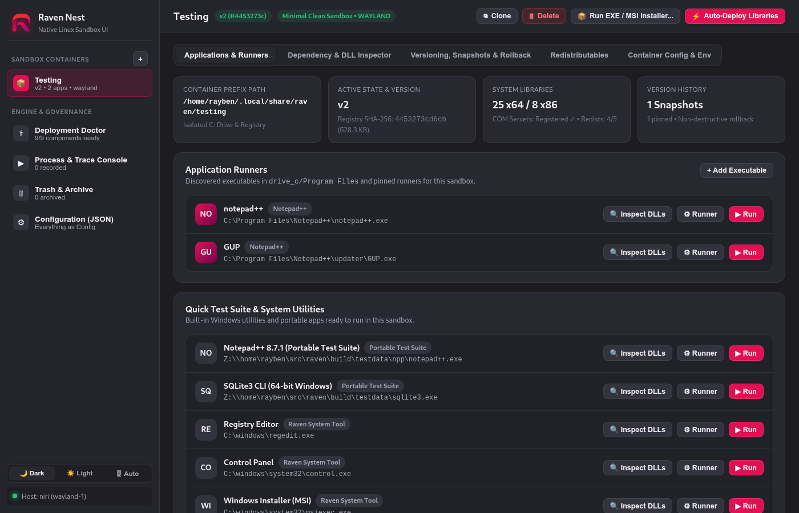
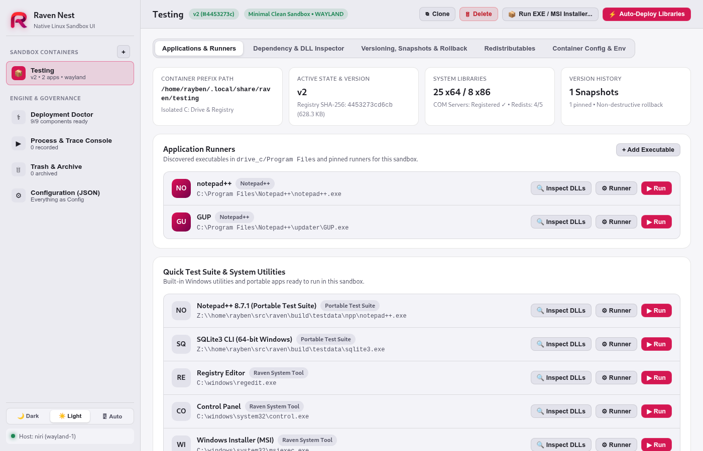

<p align="center">
  
</p>

<h1 align="center">Raven Nest</h1>

<p align="center">
  <b>Native Linux Sandbox Manager, Dependency Inspector &amp; Deployment Engine for <a href="https://github.com/mirkobrombin/raven">Raven</a></b>
</p>

---

**Raven Nest** is a native Linux desktop and web UI (inspired by Bottles / GNOME Libadwaita) for creating, versioning, inspecting, and running sandboxed Windows application containers on top of the [Raven](https://github.com/mirkobrombin/raven) runtime.

## Screenshots

### Dark Mode (Libadwaita Dark)


### Light Mode (Libadwaita Light)


---

## Key Capabilities

1. **Sandboxed Container Lifecycle ("Nests")**
   - Create isolated Windows prefixes (`drive_c` + `registry.dat`) from configurable blueprints (**Gaming & CAD Direct3D 11/12 + Qt6**, **Application Sandbox**, **Mixed 32/64-bit MSI Installer**, **Minimal Clean Sandbox**).
   - **Clone & Fork**: Duplicate any container from its live state or fork a brand-new container from any historical snapshot.
   - **Safe Deletion & Recovery**: Move containers to a recoverable Trash archive (`~/.local/share/raven/.trash/`) with full snapshot preservation, or permanently delete them.
   - **Per-Container Environment & Config**: Customize display backend (`wayland` / `x11`), blueprint metadata, notes, and environment variables (`RAVEN_BACKTRACE`, `RAVEN_THEME`, etc.).

2. **Versioning, Snapshotting & Non-Destructive Rollback**
   - Every container tracks sequential versions (`v1`, `v2`, `v3`...) fingerprinted by the SHA-256 digest of `registry.dat`.
   - **Milestone Pinning**: Tag and pin important versions so automatic retention pruning never removes them.
   - **Non-Destructive Rollback**: Rolling back to any historical version automatically captures a `before-restore` snapshot of the current state first.

3. **Automatic PE Binary & Transitive DLL Inspector**
   - Uses `raven --inspect` across executables and their transitive app-local DLLs to classify every dependency:
     - **Raven Core Syscall/Win32 Providers** (`kernel32.dll`, `user32.dll`, `gdi32.dll`, `mfplat.dll`, `xinput1_4.dll`, plus app-local override detection)
     - **Raven Provisioned Runtime Components** (`ucrtbase.dll` / `ucrtbase32.dll`, `raven-rtl.dll`, `raven-dwrite.dll`, `d3d11.dll`, `dxgi.dll`, `d3d12.dll`, `d3dcompiler_47.dll`, `avifil32.dll`, `comctl32.dll`, `oleaut32.dll`)
     - **Container Redistributables (`system32` / `syswow64`)** (Visual C++ 2010/2013/2015–2022, DirectX June 2010, .NET `mscoree.dll`)
   - **Automatic `.msi` Wrapping**: Detects OLE Compound Document headers (`D0 CF 11 E0...`) and automatically wraps `.msi` installers through `msiexec.exe /i Z:\path\to\package.msi` while verifying 32-bit `SysWOW64\msiexec.exe` support for custom actions.
   - **Idempotent 1-Click Auto-Deploy**: Stages required runtime components and redistributables using SHA-256 verification (performing zero redundant writes when already in sync).

4. **Deployment & Provisioning Doctor (`D1`–`D13`)**
   - Audits all 9 Raven runtime component groups, host MinGW cross-compilation tools, CMake source directory consistency, and host Liberation font SHA-256 hashes (`-DFONT_HASHES`), with 1-click provisioning and CMake reconfiguration.

5. **Application Runners & Linux Desktop Integration**
   - Automatically discovers installed applications inside `drive_c/Program Files` and `Program Files (x86)`.
   - Exports standalone Linux launcher scripts (`~/.local/bin/raven-...`) and XDG `.desktop` entries (`~/.local/share/applications/`).

---

## Core Design Principles

Raven Nest strictly adheres to five engineering principles (recorded in [`AGENTS.md`](AGENTS.md)):

- **DRY (Don't Repeat Yourself)**: Shared utilities for SHA-256 hashing, idempotent file syncing, API handling, and UI rendering.
- **KISS (Keep It Simple, Stupid)**: Clean modular Python backend services + zero-build-step modern HTML/CSS/JS frontend + lightweight C++20 GTK3/WebKit2GTK native Linux window host.
- **SOLID**: Single-responsibility service modules under [`services/`](services/):
  - [`config_service.py`](services/config_service.py) — Configuration loading, template variable expansion, and user override persistence.
  - [`container_service.py`](services/container_service.py) — Container CRUD, cloning/forking, environment management, and Trash archiving.
  - [`version_snapshot_service.py`](services/version_snapshot_service.py) — Versioned snapshot ledger, registry SHA-256 fingerprinting, rollback, and pruning.
  - [`dependency_service.py`](services/dependency_service.py) — PE64/PE32 & MSI inspection and idempotent library deployment.
  - [`doctor_service.py`](services/doctor_service.py) — Build/runtime health checks and CMake diagnostics.
  - [`process_service.py`](services/process_service.py) — Process execution, live stdout/stderr streaming, diagnostic pattern translation, and `.desktop` export.
- **Idempotence**: Every file deployment, container creation, snapshot operation, and configuration update verifies state first so repeated runs converge without side effects.
- **Everything as Config (No Hard-Coded Options)**: All paths, ports, timeouts, blueprints, DLL mappings, redistributable families, doctor checks, and diagnostic rules live in [`config/default.json`](config/default.json) with user overrides in `~/.config/raven-nest/config.json`.

---

## Building & Running

### Requirements
- Linux (`x86_64`) with a built [Raven](https://github.com/mirkobrombin/raven) checkout (auto-detected if placed in `raven/ui`, or set `RAVEN_ROOT=/path/to/raven`)
- Python 3.11+
- `g++` (C++20), `pkg-config`, `gtk+-3.0`, and `webkit2gtk-4.1` (for the native desktop window)

### Build the Native Desktop Binary
```bash
make
```

### Run Native Linux Desktop Window
```bash
./raven-ui
```

### Run in Web-Only / Headless Mode
```bash
./raven-ui --web
# Open http://127.0.0.1:8470 in any browser
```
